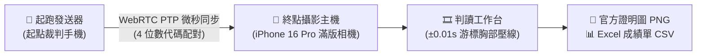
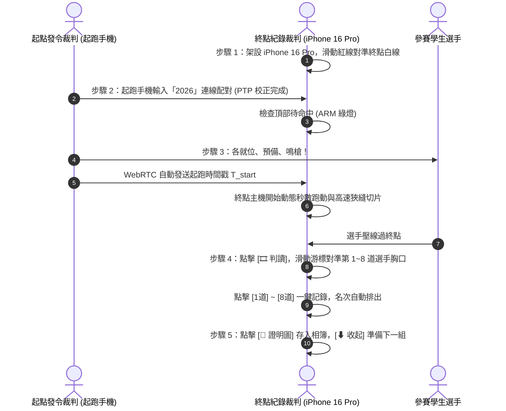

# 📱 ProFinish 終點攝影電子計時系統 (PWA) 手機版操作教學手冊

> **適用版本**：v2.0 免 Mac / 雙機無線同步版  
> **建議設備**：主機端建議使用 iPhone 16 Pro（iOS 18 Safari），起跑端支援任何 iOS / Android 手機。

---

## 🧭 目錄
1. [系統角色與運作模式](#一系統角色與運作模式)
2. [【主機端】全螢幕攝影畫面與按鈕詳解](#二主機端全螢幕攝影畫面與按鈕詳解)
3. [【選單抽屜 ☰】賽務與相機設定功能詳解](#三選單抽屜--賽務與相機設定功能詳解)
4. [【判讀抽屜 🎞️】終點畫卷與道次判讀工作台](#四判讀抽屜-️終點畫卷與道次判讀工作台)
5. [【起跑端】起跑發送器介面與三種鳴槍模式](#五起跑端起跑發送器介面與三種鳴槍模式)
6. [運動會現場實戰標準作業程序 (SOP)](#六運動會現場實戰標準作業程序-sop)

---

## 一、系統角色與運作模式

ProFinish 採雙手機無線連線架構，同一個網址在兩支手機上分別切換為不同角色：



- **🏁 終點攝影主機**：架設於終點線正上方或側面，以 **100% 全螢幕滿版攝影畫面** 取景，負責高速狹縫掃描切片與成績判讀。
- **🔫 起跑發送器**：位於 60m / 100m / 200m 起點處，發令裁判鳴槍或點擊按鈕時，微秒級同步啟動終點主機計時。

---

## 二、【主機端】全螢幕攝影畫面與按鈕詳解

打開系統預設即進入**「全螢幕攝影優先」**介面，視野最大化，所有雜訊均已收納：

```
+-------------------------------------------------------------+
| [⚡ 100m · 第1組 ▼]      [ 00:12.35 ]     [🎞️ 判讀] [☰ 選單] | <-- 頂部懸浮膠囊
|                                                             |
|                              |                              |
|                              | 終點基準線 [50%]              |
|                              | (紅色貫穿線)                  |
|                              |                              |
|                  滿版相機即時取景畫面 (100%)                  |
|                              |                              |
|                              |                              |
|   [ 🎯 待命中 ]     [ ⚡ 手動起跑 ]     [ 重置 ]    [ 🎞️ 判讀 ]  | <-- 底部操作膠囊
+-------------------------------------------------------------+
```

### 1. 畫面中央要素
- **紅色垂直終點基準線**：貫穿全螢幕的紅色垂直線，用來對準操場跑道白色終點線的**前緣**。
- **標籤 `終點基準線 [50%]`**：
  - 點擊標籤會彈出「左右微調滑桿」。
  - 手機若放置稍微偏左或偏右，拉動滑桿（5%～95%）即可精準對準跑道線，不需費力移動腳架。

### 2. 頂部懸浮 HUD 膠囊
- **左側 `[⚡ 100m · 第 1 組 ▼]`**：即時顯示目前賽事距離與組別。點擊它可快速展開功能選單。
- **中央 `[ 00:00.00 ]` 數位碼錶**：
  - 待命中呈現**綠光**。
  - 起跑計時中呈現**紅光動態跳秒**。
- **右側 `[🎞️ 判讀]`**：快速滑出終點畫卷工作台。
- **右側 `[☰ 選單]`**：展開賽務設定、鏡頭切換與雙機配對抽屜。

### 3. 底部懸浮操作膠囊
- **`[ 🎯 待命中 (ARM) ]`**：
  - 綠色代表系統處於待命狀態，接收到起跑訊號時會立即啟動計時與高速掃描。
  - 再按一次可變更為灰色（已鎖定），避免誤觸發。
- **`[ ⚡ 手動起跑 ]`**：
  - 若採單機測試或手動目視發令，按下此鍵瞬間啟動計時與狹縫掃描。
- **`[ 重置 ]`**：
  - 清空當前計時碼錶與畫卷，回到 00:00.00，為下一組選手做準備。
- **`[ 🎞️ 判讀 ]`**：
  - 選手壓線過終點後，點擊此按鈕，底部全螢幕判讀工作台立即滑出！

---

## 三、【選單抽屜 ☰】賽務與相機設定功能詳解

點擊右上角 **`☰`** 或頂部賽事標籤時，右側滑出功能抽屜：

| 功能項目 | 選項 / 操作說明 |
| :--- | :--- |
| **操作模式** | `[🏁 終點攝影主機]` 或 `[🔫 起跑發送器]`（單鍵切換手機角色） |
| **競賽距離** | `[60m]`、`[100m]`、`[200m]`（一鍵切換，連動成績單項目名稱） |
| **當前組別** | 下拉選單選擇第 1、2、3... 組，或點擊 `[+ 新增組別]` |
| **切換相機鏡頭** | 可選擇 iPhone 16 Pro 後置超廣角、主鏡頭 1x、望遠長焦鏡頭（消除跑道視差） |
| **補光燈 💡** | 點擊開啟/關閉後置手電筒，適合陰天或傍晚賽事補光 |
| **狹縫切片寬度** | `1px`（極致細緻）、`2px`（標準推薦）、`3px`（高速延展） |
| **雙機房間配對碼** | 顯示預設的 `2026`（起跑發送器手機輸入此 4 位數即可秒連） |

> [!TIP]
> 設定完成後，點擊最下方 **「關閉選單，回到攝影畫面」**，抽屜即刻滑回，維持 100% 純淨取景畫面。

---

## 四、【判讀抽屜 🎞️】終點畫卷與道次判讀工作台

選手通過終點後，點擊底部的 **`[🎞️ 判讀]`** 按鈕，全功能判讀工作台自底部滑起：

```
+-------------------------------------------------------------+
| 🎞️ 終點掃描畫卷與判讀 (第1組·100m)   [ - 1.0x + ]  [⬇ 收起回到攝影] |
+-------------------------------------------------------------+
|                                                             |
|           [ 終點時間軸動態畫卷 (手指左右滑動) ]                |
|                      |  [黃色時間游標]                        |
|                      O  (圓圈對準選手胸口軀幹)                 |
|                      |                                      |
+-------------------------------------------------------------+
| 微調: [-0.05s] [-0.01s] [+0.01s] [+0.05s]  官方成績: 12.35s  |
| 一鍵填入: [1道] [2道] [3道] [4道] [5道] [6道] [7道] [8道]      |
+-------------------------------------------------------------+
| 📋 本組成績表 (道次/姓名/官方成績/名次)  [匯入CSV] [📊成績] [📸證明圖] |
+-------------------------------------------------------------+
```

### 1. 畫卷瀏覽與十字游標對位
- **手指左右滑動**：在畫卷區域任意滑動，黃色垂直時間游標隨指針移動。
- **縮放控制 `[- 1.0x +]`**：支援 0.5x 至 4.0x 局部放大，看清選手細節。
- **十字圓圈目標**：依國際田徑總會 (World Athletics) 規則，將十字線中心對準選手**軀幹（胸骨前緣）**，非手臂或頭部。

### 2. 微調步進與國際規則進位
- **微調按鈕**：提供 `[-0.01s]` 與 `[+0.01s]` 精密微調，點一下移動 0.01 秒。
- **官方成績 (進位至 0.01s)**：系統自動採用**無條件進位制**（例如游標讀數為 `12.341s`，官方成績自動進位為 `12.35s`）。

### 3. 一鍵道次綁定 (1～8 道)
- 對準第 1 位壓線選手胸口 ➜ 點擊下方 **`[1道]`**（或該選手實際道次）。
- 畫卷上立即在該時間刻度釘上一支**彩色道次旗標**，成績同步寫入下方成績單，並**自動重新計算 1～8 名名次**！

### 4. 匯出成果
- **`[📸 匯出壓線證明圖]`**：自動將選手壓線畫面、官方標籤、組別與名次合成一張高解析度 `.png` 圖片，存入手機相簿。
- **`[📊 匯出成績單]`**：匯出一鍵可用 Excel 開啟的 UTF-8 (BOM) `.csv` 成績總表。
- **`[⬇ 收起回到攝影]`**：判讀完成後，點此按鈕立即收起工作台，鏡頭已為下一組選手準備就緒！

---

## 五、【起跑端】起跑發送器介面與三種鳴槍模式

將第二支手機點擊右上角切換至 **【🔫 起跑發送器】** 模式：

### 1. 雙機極速配對
1. 在輸入框填入終點主機的 4 位數代碼（例如 `2026`）。
2. 點擊 **`[連線]`**，約 1～2 秒內建立 WebRTC 直連，同步狀態亮起綠燈。

### 2. 三大起跑發送模式
1. **全螢幕防呆大按鈕（手動視覺觸發）**：
   - 螢幕中央超大橘紅色按鈕 **`[🔫 鳴槍起跑 (START)]`**。
   - 發令裁判看到舉旗或扣扳機瞬間按下，手機震動回饋並微秒級同步啟動終點主機。
2. **自動發令員模式 (Self-Starter)**：
   - 點擊 **`[📢 自動發令員]`**。
   - 手機會自動以語音播報：「各就位」➜（暫停 1.5 秒）➜「預備」➜（隨機等待 1.5～2.2 秒）➜ 震撼發令槍響！
   - 槍聲響起瞬間 0 延遲同步啟動終點計時。
3. **聲學麥克風瞬態偵測（真實槍聲/哨音）**：
   - 點擊 **`[開啟麥克風]`**，把手機放在發令員身邊或口袋。
   - 當發令真槍或電子鳴槍發出巨大爆鳴聲時，分貝儀突破門檻自動發送起跑信號。

---

## 六、運動會現場實戰標準作業程序 (SOP)



### 現場貼心建議：
1. **防誤觸保護**：每組跑完判讀後，點擊「重置」前，可先點「📸 證明圖」存檔，以備爭議時有圖為證。
2. **手機電力**：建議終點主機 iPhone 接上行動電源，確保 60 FPS 連續拍攝不降頻。
3. **光線與角度**：下午逆光時，可在選單中開啟「補光燈 💡」或稍微調高狹縫寬度至 2px，讓壓線畫卷清晰銳利。
